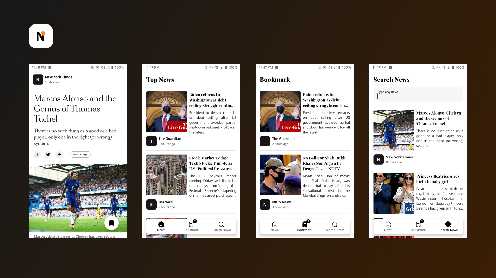
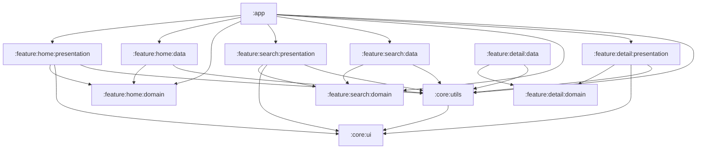

# Today News App

[](https://kotlinlang.org)
[](https://github.com/google/ksp)
[](https://developer.android.com/build)
[](https://gradle.org)
[](https://developer.android.com/about/versions/16)
[](LICENSE)

**Today News App** is a modern, modular Android application built with **Clean Architecture**, **MVVM**, and modern Android development best practices. It provides a clean, responsive interface to explore the latest news headlines across various categories (Business, Technology, Sports, Entertainment, Health, Science), search articles in real-time, read news in an integrated web reader, and bookmark favorite articles for offline access.

---

## Screenshots

<p align="center">
  
</p>

---

## Features

- **Top Headlines & Category Browsing**: Stay updated with the latest news filtered by categories (General, Business, Entertainment, Health, Science, Sports, Technology).
- **Infinite Scrolling**: Smooth, paged article streams powered by **Jetpack Paging 3**.
- **Real-Time Search**: Search articles by keyword with debounced input streams using **FlowBinding** and Kotlin Coroutines.
- **In-App Article Reader**: View complete articles in an integrated WebView with loading progress and modern `WebViewClient` handling.
- **Offline Bookmarks**: Save and manage favorite articles locally using **Room Database**.
- **Edge-to-Edge Experience**: Modern edge-to-edge UI (`enableEdgeToEdge()`) with dynamic Window Insets handling for status and navigation bars.
- **In-App Debugging**: Integrated **Pluto** network interceptor and diagnostic suite in debug builds for real-time HTTP traffic and performance monitoring.

---

## Architecture & Modularization

The project adopts a multi-module Clean Architecture approach. Each feature is cleanly segregated into `data`, `domain`, and `presentation` layers to promote testability, separation of concerns, and independent scalability. Cross-feature navigation is decoupled via interface injection (`Navigator.Provider`).

```
NewsApp/
├── app/                                 # Application entry point, splash screen & DI aggregation
│
├── core/                                # Reusable shared modules
│   ├── ui/                              # Design system, reusable UI components, themes & assets
│   └── utils/                           # Core utilities, extensions, navigation contracts & API config
│
├── feature/                             # Feature-specific modules
│   ├── home/                            # Home screen, headlines, categories & bookmarks tab
│   │   ├── data/                        # News repository implementation, remote data sources & mappers
│   │   ├── domain/                      # Domain models, repository contracts & use cases
│   │   └── presentation/                # HomeActivity, TopHeadlinesFragment, BookmarkFragment & ViewModels
│   │
│   ├── search/                          # Article search feature
│   │   ├── data/                        # Search API service, repository implementation & DTOs
│   │   ├── domain/                      # Search use cases & domain repository interfaces
│   │   └── presentation/                # SearchActivity, SearchViewModel & search adapters
│   │
│   └── detail/                          # Article detail & reader feature
│       ├── data/                        # Article persistence & bookmarking data logic
│       ├── domain/                      # Detail use cases (bookmarking, article retrieval)
│       └── presentation/                # DetailArticleActivity & web reader UI
│
└── build-logic/                         # Gradle convention plugins for standardized module configurations
```

### Modular Dependency Graph



---

## Tech Stack & Libraries

### Build System & Toolchain
- **Gradle 9.8.2** with **Android Gradle Plugin (AGP) 9.5.0**
- **Kotlin Symbol Processing (KSP) 2.3.13**: Modern, high-performance annotation processing replacing KAPT
- **Gradle Version Catalog** (`gradle/libs.versions.toml`) for centralized versioning
- **Build-Logic Convention Plugins**:
  - `newsapp.android.application`
  - `newsapp.android.library`
  - `newsapp.android.hilt` (integrated with KSP)
- **Kotlin 2.4.21** (target JVM 17)
- **Compile SDK / Target SDK**: 37 (Android 16), **Min SDK**: 26 (Android 8.0)

### Architecture & Dependency Injection
- **Clean Architecture** (Data, Domain, Presentation)
- **MVVM Pattern** (Model-View-ViewModel)
- **Dagger Hilt 2.60.1**: Dependency injection across all feature and core modules via KSP
- **Navigation Component (SafeArgs)** & Decoupled `Navigator.Provider`

### Reactive & Asynchronous
- **Kotlin Coroutines & Flow**: Asynchronous programming and reactive streams
- **FlowBinding 1.2.0**: Coroutine Flow bindings for Android UI widgets
- **AndroidX Lifecycle 2.11.0**: ViewModel, LiveData, and lifecycle-aware coroutine scopes
- **AndroidX Paging 3 (3.5.3)**: Reactive pagination and stream caching

### UI & UX
- **AndroidX Edge-to-Edge**: Full edge-to-edge support with custom Window Insets handling
- **ViewBinding**: Type-safe layout views
- **Material Components 1.14.0**: Modern Android UI components
- **Glide 5.0.9**: Image loading and caching
- **Lottie Android 6.7.1**: Vector-based animations
- **Facebook Shimmer 0.5.0**: Skeleton loading states

### Network & Data Storage
- **Retrofit 3.0.0** & **OkHttp 5.5.1**: REST API client and HTTP logging
- **Room Database 2.8.5**: SQLite object mapping with KSP compiler for offline bookmark caching
- **Pluto 2.2.2**: In-app HTTP network inspector and diagnostic bundle (debug builds)

---

## Getting Started

### Prerequisites
- **Android Studio**: Ladybug (2024.2) / Meerkat (2024.3) or newer
- **JDK**: Java 17
- **Android SDK**: API Level 37

### 1. Clone the Repository
```bash
git clone https://github.com/arrazyfathan/NewsApp.git
cd NewsApp
```

### 2. Configure News API Key
The app uses [News API](https://newsapi.org/) to fetch articles.
1. Sign up for a free developer key at [newsapi.org](https://newsapi.org/register).
2. Open or create the `local.properties` file in the project root directory.
3. Add your API key:
   ```properties
   API_KEY=your_actual_news_api_key_here
   ```
   > [!NOTE]
   > `:core:utils` reads `API_KEY` from `local.properties` at build time and exposes it via `BuildConfig.API_KEY`.

### 3. Build & Run
Compile and run the debug build on an emulator or connected device:

```bash
# Build debug APK
./gradlew assembleDebug

# Install and run on connected device
./gradlew installDebug
```

---

## Demo Videos

- [Feed & Categories Browsing Demo](https://github.com/arrazyfathan/NewsApp/assets/18359255/0da726ae-bc1d-46ec-9b9c-1f467dc86734)
- [Search Feature Demo](https://github.com/arrazyfathan/NewsApp/assets/18359255/084fee83-5267-4ceb-b8b2-ae4f111f9cb8)
- [Article Reader & Bookmarks Demo](https://github.com/arrazyfathan/NewsApp/assets/18359255/3529ff02-02b9-43ce-bbae-86954da93e9a)

---

## License

```text
MIT License

Copyright (c) 2021 Ar Razy Fathan Rabbani

Permission is hereby granted, free of charge, to any person obtaining a copy
of this software and associated documentation files (the "Software"), to deal
in the Software without restriction, including without limitation the rights
to use, copy, modify, merge, publish, distribute, sublicense, and/or sell
copies of the Software, and to permit persons to whom the Software is
furnished to do so, subject to the following conditions:

The above copyright notice and this permission notice shall be included in
all copies or substantial portions of the Software.

THE SOFTWARE IS PROVIDED "AS IS", WITHOUT WARRANTY OF ANY KIND, EXPRESS OR
IMPLIED, INCLUDING BUT NOT LIMITED TO THE WARRANTIES OF MERCHANTABILITY,
FITNESS FOR A PARTICULAR PURPOSE AND NONINFRINGEMENT. IN NO EVENT SHALL THE
AUTHORS OR COPYRIGHT HOLDERS BE LIABLE FOR ANY CLAIM, DAMAGES OR OTHER
LIABILITY, WHETHER IN AN ACTION OF CONTRACT, TORT OR OTHERWISE, ARISING FROM,
OUT OF OR IN CONNECTION WITH THE SOFTWARE OR THE USE OR OTHER DEALINGS IN
THE SOFTWARE.
```
